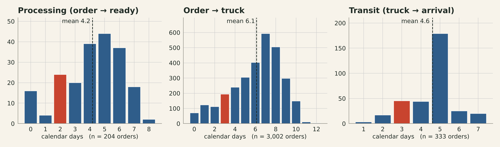
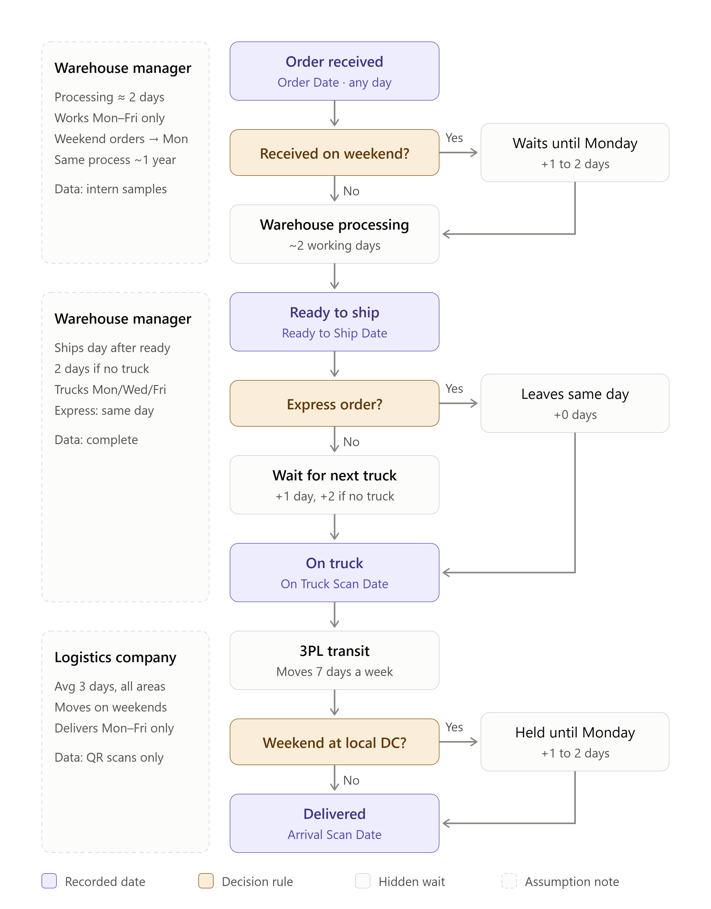
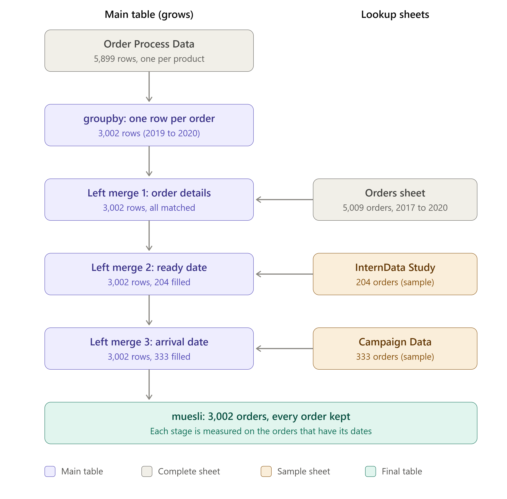

# Muesli Delivery Process: Exploratory Data Analysis

How long does a muesli order really take to reach the customer? This project checks what a distribution company's warehouse manager and logistics partner *believe* about the delivery process against two years of order data, and proposes KPIs to monitor the health of the business.


*Red = value the company or the logistics provider assumes · Blue = actual orders*

## Key findings

- **57% of orders reach the truck later than the warehouse's own process says they should.** Standard orders are on average 2.4 days late. This is measured on all 3,002 orders.
- **The time estimates don't hold.** Processing takes 2.8 working days on average (claimed: 2), and transit takes 4.6 days (claimed: 3); 80% of deliveries take longer than 3 days.
- **The schedule rules mostly do hold.** Trucks leave Mon/Wed/Fri (96% of scans), the next-truck and same-day Express rules are followed for 90% and 94% of orders, and there are no weekend deliveries.
- **Express is worth it:** about 7 days from order to arrival vs 12 for Standard. Surprisingly, most of the gain comes from faster *processing* (2.0 vs 4.9 days), which isn't part of the official process.
- Region and sales channel make no difference (≈6.1 days from order to truck everywhere).

## The business problem

A muesli distributor wants KPIs for its delivery process. Two partners describe it:

| Source | Claims |
|---|---|
| Warehouse manager | Processing ≈ 2 days · warehouse works Mon–Fri · trucks leave Mon/Wed/Fri · Standard orders go on the next truck after they're ready, Express on the same day |
| Logistics company | Average transit of 3 days · deliveries on weekdays only |



## Data

`data/muesli_raw_data.xlsx` has four sheets:

| Sheet | Orders | Contains | Coverage |
|---|---|---|---|
| Orders | 5,009 | customer, region, channel, sales | 2017–2020 |
| Order Process Data | 3,002 | order date + truck scan date | **complete**, 2019–2020 |
| InternData Study | 204 | ready-to-ship date | sample, Sep–Oct 2019 & Nov–Dec 2020 |
| Campaign Data | 333 | arrival scan date (QR code) | sample, May 2019 – May 2020 |

## Approach

1. **Cleaning:** standardised column names and removed 86 duplicated rows in the intern sheet. Found that the intern pickup date always equals the truck scan date, and that one order has two truck dates (the latest is kept).
2. **One row per order:** the process sheet has one row per *product*, so it is grouped by `order_id` first. Without this, orders with many products would count several times.
3. **Left merges:** all 3,002 orders are kept, and the sample sheets fill in dates where available. An inner merge would leave only 22 orders.

   

4. **Stage durations** in calendar days and in working days (`np.busday_count`), because the warehouse is closed at weekends.
5. **Checking the claims:** the percentage of orders matching each claim, plus a replay of the manager's rules for every order to get an *expected* truck date to compare with the real one.
6. **Diagnostics:** mean, median, 95th percentile and coefficient of variation per stage, split by Express/Standard, order weekday, region and channel.

## KPIs proposed

| KPI | Calculation | Orders |
|---|---|---|
| Order → truck time | truck − order | 3,002 |
| On time to truck | truck ≤ expected truck date | 3,002 |
| Processing time | ready − order | 204 |
| Truck wait | truck − ready | 204 |
| Transit time | arrival − truck | 333 |
| Total delivery time | arrival − order | 333 |

## Repository structure

```
├── muesli_analysis.ipynb   # full analysis with outputs
├── data/                   # raw Excel file
├── images/                 # flowchart, merge diagram, charts
├── slides/                 # stakeholder presentation (PDF)
└── requirements.txt
```

## How to run

```bash
pip install -r requirements.txt
jupyter notebook muesli_analysis.ipynb
```

## Limitations

- Processing and transit figures come from small samples (7% and 11% of orders) covering limited periods.
- 22 orders are marked ready on the day they were ordered, and 4% of truck scans fall on days without a scheduled truck. These were kept but flagged.

## Next steps

- Simulate complete orders by sampling from the partial data, to estimate average and 95th-percentile delivery time by order weekday.
- Compare two options for reducing lead time: daily truck pickups vs handling every order as Express.

## Team & credits

Project from NeueFische Data Analysis and AI course, October 2026.

- **Carlos Musetti:** data cleaning, merging, stage metrics and analysis notebook, presentation

**Tools:** Python · pandas · NumPy · Matplotlib · Seaborn · Jupyter
